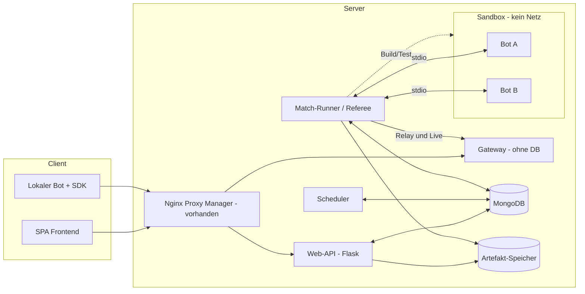

# Systemübersicht

## Komponenten



| Komponente | Verantwortung | Detail |
|------------|---------------|--------|
| SPA | Anzeige, Viewer, Upload-UI, Admin-UI, Mensch-gegen-Bot | [frontend.md](../komponenten/frontend.md) |
| Web-API (Flask) | REST, Auth, Rollen, Validierung; schreibt Jobs, führt **nie** Bot-Code aus; den Live-Kanal bedient der Gateway (E142) | [backend-api.md](../komponenten/backend-api.md) |
| MongoDB | Persistenz aller Stammdaten, Partien, Tabellen, Jobs | [datenmodell.md](../komponenten/datenmodell.md) |
| Artefakt-Speicher | Quellcode-Uploads, Build-Ergebnisse, Bot-Logs in GridFS (E82) | [verifikation.md](../komponenten/verifikation.md) |
| Scheduler | Erzeugt Saisons, Turniere, Paarungen und Match-Jobs nach Konfiguration | [ligen-turniere.md](../komponenten/ligen-turniere.md) |
| Match-Runner | Referee: autoritativer Spielzustand, Uhren, Start/Stopp der Bot-Prozesse; führt auch die Verifikation aus (E81). Als Play-Runner (eigener Container) spielt er die interaktiven Partien (E111) | [match-runner.md](../komponenten/match-runner.md) |
| Gateway | WebSockets von Browsern und lokalen Bots; paart sie über ein eigenes Relay-Netz mit dem Play-Runner, ohne Datenbankzugang (E112); nimmt über das Netz `live` die Züge laufender Partien von den Runnern an und liefert sie als Server-Sent Events (E142) | [gateway.md](../komponenten/gateway.md) |
| Verifikation (im Runner) | Statische Analyse, Build, Mindesttests für hochgeladene Bots | [verifikation.md](../komponenten/verifikation.md), [statische-analyse.md](../komponenten/statische-analyse.md) |
| Sandbox (nsjail) | Isolierte Ausführung je Bot-Prozess | [sandbox.md](../komponenten/sandbox.md) |
| Schachkern (C++) | Einzige Regelimplementierung; genutzt von Referee, Arena und allen SDKs | [sdk-api.md](../komponenten/sdk-api.md), [kern-c-schnittstelle.md](../komponenten/kern-c-schnittstelle.md) |
| SDKs (×5) | Binding auf den Kern, Bot-API, Debug-Logging, Protokoll-Client | [sdk-api.md](../komponenten/sdk-api.md) |
| Lokale Arena / Remote-Client | Entwicklung und Debugging ohne Server bzw. gegen die Web-API | [lokale-entwicklung.md](../komponenten/lokale-entwicklung.md) |

## Vertrauensgrenzen

| Zone | Enthält | Regel |
|------|---------|-------|
| Öffentlich | SPA, Web-API, Gateway | Kann keine Prozesse starten, kein Bot-Code; der Gateway hat keinen Datenbankzugang |
| Intern vertrauenswürdig | Scheduler, Runner, DB | Nicht von außen erreichbar; nur der Runner darf Sandbox-Prozesse starten |
| Nicht vertrauenswürdig | Bot-Code (auch beim **Kompilieren**), Uploads, Eingaben lokaler Bots | Nur in der Sandbox; jede Ausgabe wird als feindliche Eingabe behandelt |

Kernprinzipien:

- **Referee ist autoritativ.** Jeder Zug wird serverseitig geprüft; ein manipuliertes SDK im Bot-Prozess bringt keinen Vorteil.
- **Bots kommunizieren nie direkt.** Die Sprachunabhängigkeit entsteht ausschließlich über das [Bot-Protokoll](../komponenten/bot-protokoll.md).
- **Ein Spieler-Interface, mehrere Adapter.** Der Referee kennt nur „Spieler“: Sandbox-Bot, Remote-Bot und Mensch (beide über den Gateway, E112). Damit teilen sich Liga-Spiele, Remote-Spiele und Mensch-gegen-Bot dieselbe Spiellogik.
- **Alles Konfigurierbare liegt in der DB** (Disziplinen, Ligen, Turniere, Queue, Limits) und ist über die Website einstellbar (E13).
- **Eine Regelimplementierung.** Referee, Arena und alle SDKs nutzen denselben C++-Kern.

## Repo-Struktur (Monorepo)

```
SchachBotManager/
├── docs/                    Konzept und Spezifikationen
├── spec/                    Protokoll-Schema, kanonische API-Definition, Testvektoren (Perft, Regeln, FEN/UCI/SAN, API)
├── backend/                 Flask-API (sbm-api; E76, Konten und Admin-Routen E83–E85)
├── frontend/                SPA
├── services/
│   ├── store/               Gemeinsamer Datenbankzugriff, Migrationen (sbm-store, E75)
│   ├── runner/              Match-Runner (Job-Consumer, Sandbox-Adapter), auch als Play-Runner (E111); Referee-Kern aus sdk/python (E65, E75)
│   └── gateway/             WebSocket-Gateway für interaktive Partien und Live-Kanal (sbm-gateway, E112, E142)
├── sdk/
│   ├── core/                C++-Schachkern + C-Schnittstelle
│   ├── python/              Binding, Referee-Kern (sbm.referee), lokale Arena (sbm.arena, E65), Referenzbots (sbm.bots, E68), statische Analyse (sbm.analysis, E90), Anbindung des Viewers (sbm.viewer, E107)
│   ├── csharp/              C#-SDK (Sbm.slnx, Bibliothek src/Sbm mit Referee und Sdk.Play, Referenzbot bots/Material, Tests tests/Sbm.Tests, Kreuztest tests/cross, NuGet-Paket SchachBotManager mit Viewer), erste Sprache von M5 (E192, E199, E206–E209)
│   └── viewer/              Viewer-Programm sbm-viewer (C++, SDL3, Dear ImGui), in jedem SDK-Paket mitgeliefert (E106, E107)
├── templates/               Vorlagenprojekte je Sprache mit Debug-Konfiguration (python/, E69; csharp/, E201)
├── tools/
│   ├── spec-check/          Prüft alle JSON-Dateien unter spec/ (CI)
│   └── testvector-gen/      Erzeugt die Testvektoren unter spec/testvectors/ (Entwicklungswerkzeug, E54)
├── sandbox/                 nsjail-Konfiguration und Laufzeitverzeichnisse je Sprache
├── deploy/                  docker-compose, Dockerfiles, Beispiel-Umgebungsdatei
└── .github/                 Workflows (ci, deploy, wheels, nuget) und Skripte der CI
```

Die Verifikation hat kein eigenes Paket: Der Runner führt sie aus (E81, E89), die statische Analyse liegt im SDK (E90). Das C#-SDK unter `sdk/csharp/` entsteht als erste Sprache von M5 (E192); die SDKs für C++, Java und JavaScript (`sdk/cpp/`, `sdk/java/`, `sdk/javascript/`) bleiben zurückgestellt (E110). Wie der Code in den vorhandenen Paketen aufgebaut ist, beschreiben die Code-Karten unter [`entwicklung/`](../entwicklung/README.md).
